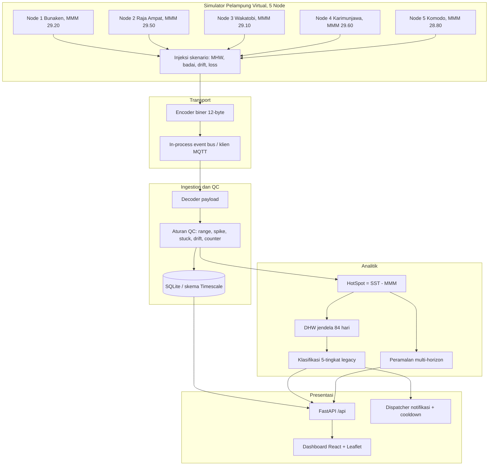

# SEGARA: Sistem Early-warning Gangguan termal Atas terumbu kaRAng

Sistem perangkat lunak untuk pemantauan kesehatan ekosistem terumbu karang: kendali mutu
telemetri (*Quality Control*), kalkulasi stres termal gaya **NOAA Coral Reef Watch**
(HotSpot & Degree Heating Weeks), peringatan dini, dan dashboard web — diuji pada telemetri
biner 12-byte yang disimulasikan.

Dokumen rujukan:

- [docs/evaluation-report.md](docs/evaluation-report.md) — laporan evaluasi, seluruh angka
  berasal dari eksekusi langsung, dengan label cakupan per klaim.
- [LAPORAN_HASIL_IMPLEMENTASI_SEGARA.md](LAPORAN_HASIL_IMPLEMENTASI_SEGARA.md) — laporan
  hasil implementasi terhadap kriteria rancangan, dengan kolom bukti dan batasan.
- [docs/methodology.md](docs/methodology.md) — landasan teori, formulasi, aturan QC.
- [docs/brand-guidelines.md](docs/brand-guidelines.md) — logo, palet warna, dan tipografi merek SEGARA.
- [hardware/README.md](hardware/README.md) — **draft** prototipe IoT (ESP32 + LoRa, gateway MQTT,
  BOM, anggaran energi); belum dirakit maupun di-compile.

---

## Status bukti (revisi 2026-11-06)

Angka dari draf sebelumnya **dicabut**: MAE DHW 0,024 °C-minggu, *r* = 0,9998, presisi QC
100%, *lead time* 35 hari, latensi 2,45 ms, reduksi cooldown 98%, MAE peramalan
0,08/0,22/0,41 °C. Rincian dan alasan pencabutan ada di bagian 8 laporan evaluasi.

Yang **terukur** saat ini:

| Komponen | Hasil | Cakupan |
|---|---|---|
| Payload 12-byte | Roundtrip `>BHhHHHB` lulus | Unit, tanpa radio fisik |
| DHW | MAE 1,219 °C-minggu, RMSE 1,941, *r* = 0,9158 | **Konsistensi internal, bukan validasi NOAA** |
| Packet loss | 100 seed berpasangan; MAE 0,0156/0,0313/0,0463 °C-minggu | Sintetis, loss Bernoulli |
| QC | Uji fungsional per aturan (§4 laporan) | **Bukan akurasi lapangan** |
| Peramalan | **Tidak dievaluasi** — cadence 5 hari membuat horizon runtuh | — |
| Latensi | Median 5 run: mean 37,83 ms, median 33,56 ms, p95 57,92 ms, p99 329,24 ms | **In-process saja**, DB sementara |
| Suite tes | **82 passed** | — |

Yang **belum** dijalankan sama sekali: TimescaleDB, broker MQTT nyata, pengiriman Telegram
ke bot nyata, `docker compose up`, dan validasi terhadap produk CRW resmi.

## Revisi perilaku (2026-11-09)

Perbaikan hasil review kode. Angka evaluator (Monte Carlo packet loss, uji fungsional QC,
konsistensi DHW) **tidak berubah**, karena fungsi yang diubah tidak dipakai evaluator.
Yang berubah adalah perilaku pipeline yang berjalan:

1. Bleaching Warning, Alert Level 1, dan Alert Level 2 kini mensyaratkan HotSpot ≥ 1
   (sebelumnya Alert 1/2 hanya dari DHW).
2. DHW dihitung dari jendela 84 hari berbasis **waktu observasi**, yang diturunkan dari
   counter × 6 jam. Kolom `timestamp` di DB kini berisi waktu simulasi, bukan jam dinding.
3. Counter, jam, dan riwayat HotSpot dipulihkan dari DB setelah restart.
4. `/api/measurements/history` mengembalikan N rekaman terbaru (sebelumnya yang tertua).
5. Paket ganda diberi flag `DUPLICATE` dan dikeluarkan dari analitik; counter mundur
   dianggap reboot, bukan paket hilang.
6. QC per parameter: data suhu tetap dipakai DHW walaupun pH/kekeruhan/baterai gagal.
   Spike dibandingkan dengan nilai valid terakhir; jendela stuck berbeda per parameter.
7. Peramalan hanya memakai SST yang lolos QC suhu.

**Stabilitas & performa (2026-11-09, lanjutan):**

8. Benchmark latensi di `/api/evaluation/metrics` dulu menulis 100 paket palsu node 1 ke
   `segara.db` live (merusak jam/DHW node 1 dan dapat memicu alert palsu). Kini memakai DB
   sementara terpisah; hasil evaluasi di-cache (`?refresh=true` untuk hitung ulang).
   Angka latensi di tabel atas sudah diukur ulang (median dari 5 run).
9. Simulasi berjalan di thread pekerja (sebelumnya memblokir event loop: latensi API
   1–10 dtk saat simulasi jalan; kini median ~35 ms).
10. SQLite: mode WAL, `busy_timeout`, dan connection pool (sebelumnya koneksi dibuka-tutup
    per paket). Bersama perbaikan Isolation Forest yang dilatih ulang pada SETIAP paket
    setelah buffer penuh, latensi pipeline per paket turun dari ~70 ms ke ~10 ms (rata-rata).
11. `qc-summary` diagregasi di SQL; riwayat pengukuran tanpa query N+1.
12. Kontrol simulator divalidasi (skenario/aksi tak dikenal → 422) dan tidak lagi mereset
    kecepatan ke 1 dtk pada setiap klik.
13. Replay historis memakai counter & sensor pelampung yang sama (tanpa paket hilang /
    sensor macet palsu); gelombang panas di simulator live naik/turun 0,15 °C per siklus.
14. Tes memakai DB sementara (`tests/conftest.py`), tidak lagi menulis ke `segara.db`.

**Pengerasan (2026-11-09, putaran ketiga):**

15. Peramalan: level peringatan proyeksi memakai aturan HotSpot ≥ 1 yang sama, lead time
    tidak lagi "1 hari" untuk ambang yang sudah terlampaui, dan cadence 6 jam dihormati
    (sebelumnya tiap sampel 6 jam dianggap 1 hari → horizon "14 hari" sebenarnya 3,5 hari
    dan DHW proyeksi 4× terlalu cepat).
16. Notifikasi: teks polos di DB/dashboard (tanpa `*` `` ` `` `_` mentah), HTML ter-escape
    untuk Telegram, dikirim di thread latar, status penolakan Telegram dicatat.
17. API: path `/api/*` tak dikenal → 404 (sebelumnya 200); `/api/health` memeriksa DB
    (503 bila gagal); CORS tidak lagi `*` + credentials (atur via `SEGARA_CORS_ORIGINS`).
18. Dashboard: polling tidak menumpuk & jeda saat tab tersembunyi, indikator koneksi
    server, CSS Leaflet dibundel lokal (tanpa CDN), ikon logo dipotong ulang.
19. Docker: build multi-tahap (dashboard ikut di-build), `.dockerignore`, driver
    PostgreSQL, healthcheck, API menunggu DB sehat, pengguna non-root.
    **Masih belum pernah dijalankan** (Docker tidak tersedia di mesin pengembang).

---

## 1. Arsitektur



Catatan: nilai MMM di atas adalah **aproksimasi manual**, bukan ekstraksi dari produk
klimatologi CRW (lihat bagian 5). Jalur transport yang benar-benar dipakai `run_segara.py`
adalah **event bus in-process**, bukan broker MQTT.

---

## 2. Struktur repositori

```
SEGARA/
├── docs/
│   ├── payload-spec.md             # Format paket biner 12-byte
│   ├── methodology.md              # Teori, formulasi, aturan QC, batasan
│   └── evaluation-report.md        # Laporan evaluasi (sumber angka)
├── simulator/
│   ├── encoder.py                  # Struct packing 12-byte (>BHhHHHB)
│   ├── generator.py                # Model oseanografi, diurnal, MHW, noise, anomali
│   ├── replay.py                   # Pemutar deret waktu acuan
│   └── publisher.py                # Klien MQTT (paho-mqtt) & fallback bus in-process
├── ingestion/
│   ├── decoder.py                  # Unpacking biner & cek panjang frame (tanpa CRC)
│   ├── subscriber.py               # Orkestrasi pipeline
│   └── database.py                 # Skema SQLAlchemy (nodes, measurements, qc_flags, alerts)
├── qc/
│   └── rules.py                    # Range, spike, stuck, drift pH, packet loss, duplikat
├── analytics/
│   ├── thermal_stress.py           # HotSpot, DHW, klasifikasi 5-tier
│   ├── anomaly.py                  # Z-Score & Isolation Forest
│   └── forecasting.py              # Holt's Linear vs persistence (belum dievaluasi)
├── api/
│   ├── main.py                     # FastAPI, CORS, serving dashboard
│   ├── alerting.py                 # Dispatcher Telegram & cooldown
│   └── routers/                    # nodes, measurements, analytics, simulator, evaluation
├── dashboard/
│   ├── src/App.tsx                 # Dashboard (peta Leaflet, grafik, QC sandbox, evaluasi)
│   └── dist/                       # Hasil build Vite
├── infra/
│   ├── docker-compose.yml          # Mosquitto, TimescaleDB, API (belum pernah dijalankan)
│   ├── mosquitto.conf
│   ├── init-timescaledb.sql
│   └── Dockerfile
├── data/
│   └── historical_noaa_indonesia.csv # Rekonstruksi, BUKAN unduhan NOAA terverifikasi
├── tests/                          # 82 tes, 11 berkas + conftest.py
│   ├── test_protocol.py
│   ├── test_qc.py
│   ├── test_analytics.py
│   ├── test_ingestion_subscriber.py
│   ├── test_alerting.py
│   ├── test_api.py
│   ├── test_evaluation.py          # 18 tes untuk evaluator
│   ├── test_fixes_review.py        # Regresi: alert, DHW berbasis waktu, restart, duplikat
│   ├── test_qc_review.py           # Regresi: QC per parameter, spike, stuck, forecast
│   ├── test_hardening.py           # Rute API, health, notifikasi, validasi, peramalan
│   └── conftest.py                 # Tes memakai DB sementara, bukan segara.db
├── run_segara.py                   # Peluncur satu langkah
└── requirements.txt
```

---

## 3. Matriks bukti per komponen

| Komponen | Bukti yang ada | Batasan |
|---|---|---|
| Payload 12-byte | `tests/test_protocol.py` lulus: roundtrip, batas ekstrem, payload rusak | Radio fisik tidak diuji |
| Ingestion & penyimpanan | `tests/test_ingestion_subscriber.py` lulus pada **SQLite** | **TimescaleDB belum pernah dijalankan** |
| MQTT | Event bus in-process dipakai `run_segara.py` | **Broker MQTT nyata belum pernah dipakai** |
| Notifikasi | `tests/test_alerting.py` lulus dengan dispatcher mock | **Telegram belum pernah mengirim ke bot nyata** |
| Docker Compose | `infra/docker-compose.yml` **valid sebagai YAML** | **Docker belum terpasang; compose belum pernah dijalankan** |
| Dashboard | `npm run build` sukses (vite 6.4.5, 1591 modul, `index-Fi-FmqXp.js` 349,95 kB); `npx tsc --noEmit` keluar 0 | Tidak ada uji UI otomatis |
| Evaluator | `tests/test_evaluation.py`, 18 tes | Angka ilmiahnya tetap sintetis |
| Suite total | `python -m pytest tests/ -q` → **82 passed**, 0 warning | — |

---

## 4. Rujukan klimatologi NOAA CRW

Draf lama mengutip laporan teknis dengan judul keliru. Koreksinya: laporan 2015 berjudul
*"Climatology Development for NOAA Coral Reef Watch's 5-km Product Suite"* dan mendokumentasikan
klimatologi berbasis **Pathfinder v5.2** yang belakangan diketahui membawa bias hangat
sehingga stres panas terhitung terlalu rendah.

Klimatologi **v3.1** berbeda: diturunkan dari kombinasi analisis SST Geo-Polar Blended
(2002–2012) dan reanalisis UK Met Office (1985–2002), dengan periode acuan **1985–1990
ditambah 1993**.

| Keperluan | Sumber |
|---|---|
| Deskripsi klimatologi 5-km v3.1 | `coralreefwatch.noaa.gov/product/5km/description_climatology.php` |
| Riwayat produk 5-km, catatan bias hangat & revisi 2023 | `coralreefwatch.noaa.gov/product/5km/history_5km_products.php` |

Sistem kategori peringatan yang diimplementasikan adalah **sistem 5-tingkat lama**. NOAA CRW
merevisinya pada **15 Desember 2023** dengan menambahkan Alert Level 3 sampai 5. SEGARA
**belum** mengimplementasikan level 3–5.

---

## 5. MMM stasiun: aproksimasi manual

| Node | Stasiun | Koordinat | MMM (°C) | Ambang +1 °C |
|---|---|---|---|---|
| 1 | Bunaken Reef | 1,6240° N, 124,7570° E | 29,20 | 30,20 |
| 2 | Raja Ampat Kri | 0,5510° S, 130,6720° E | 29,50 | 30,50 |
| 3 | Wakatobi Tomia | 5,5120° S, 123,7540° E | 29,10 | 30,10 |
| 4 | Karimunjawa | 5,8520° S, 110,4530° E | 29,60 | 30,60 |
| 5 | Komodo Padar | 8,5520° S, 119,5310° E | 28,80 | 29,80 |

**Sumber: tidak ada.** Nilai ditetapkan manual. Tidak diambil dari `ct5km_climatology_v3.1.nc`,
tidak dari virtual station CRW, dan tanpa tanggal akses. Kesalahan 0,3 °C pada MMM menggeser
awal Bleaching Warning sebesar 0,3 °C.

Untuk penggunaan nyata: unduh MMM dari klimatologi CRW v3.1 untuk setiap koordinat, catat
tanggal akses, ganti nilai di `simulator/generator.py`, lalu ulangi evaluasi.

---

## 6. Menjalankan

```powershell
python run_segara.py
```

- Dashboard: `http://127.0.0.1:8000/`
- Swagger: `http://127.0.0.1:8000/docs`

Pengujian:

```powershell
python -m pytest tests/ -q      # 82 passed
```

Dashboard build:

```powershell
cd dashboard
npm run build
npx tsc --noEmit
```

Reproduksi angka evaluator: lihat bagian 11 laporan evaluasi.

---

## 7. Keterbatasan

1. **Tidak ada validasi NOAA.** Berkas `data/historical_noaa_indonesia.csv` menyebut dirinya
   rekonstruksi, tanpa URL, tanggal akses, atau checksum. Kolom `dhw_official` di dalamnya
   melanggar definisi DHW 84-hari sehingga tidak dapat dipakai sebagai pembanding sah.
2. **Tidak ada ground truth lapangan.** Uji QC dibangun dari spesifikasi aturan sendiri.
3. **Tidak ada kejadian pemutihan historis.** Karena itu tidak ada klaim *lead time* pemutihan.
4. **Peramalan tidak dievaluasi.** Cadence 5 hari membuat horizon 1 dan 7 hari identik.
5. **Infrastruktur produksi belum diuji.** TimescaleDB, broker MQTT, Telegram, Docker.
6. **Kanal radio tidak dimodelkan.** Loss Bernoulli independen, bukan propagasi LoRaWAN.
7. **Latensi hanya in-process.** End-to-end belum diukur.
8. **Simulasi perangkat lunak.** Tidak ada klaim ketahanan biofouling, korosi, atau baterai.
