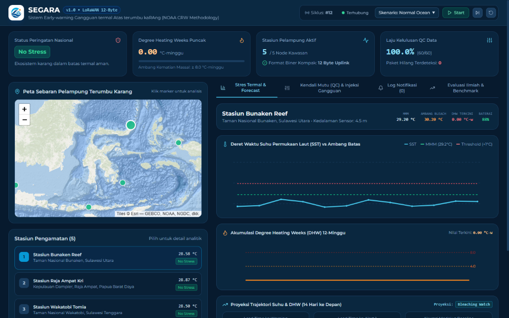
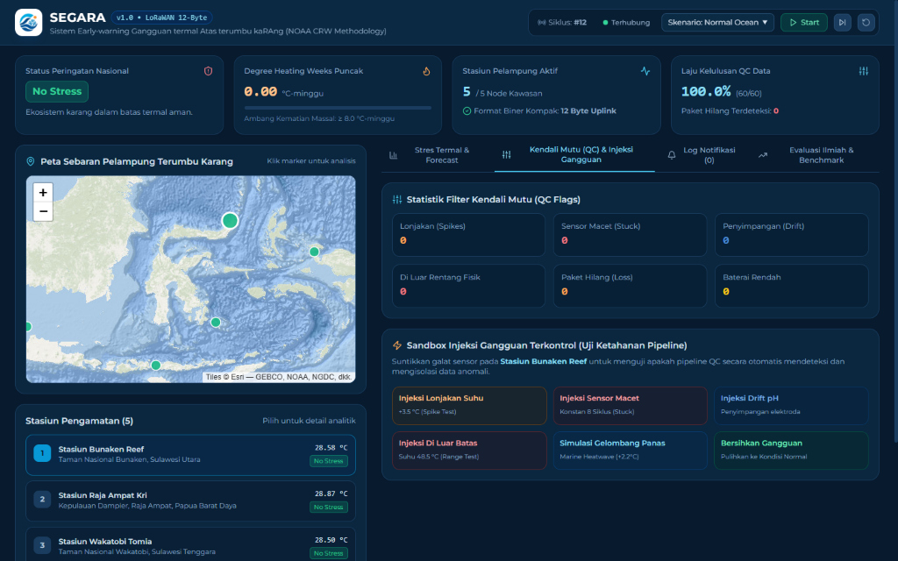
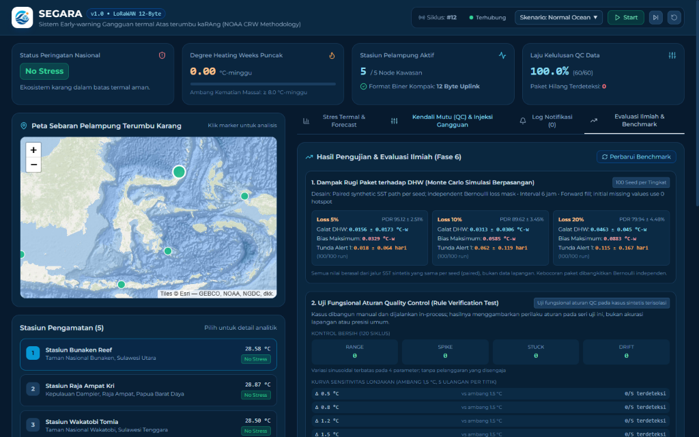

<div align="center">


### Coral reef thermal-stress telemetry QC, NOAA CRW-style analytics &amp; early-warning dashboard

Validate simulated 12-byte buoy telemetry. Compute HotSpot &amp; Degree Heating Weeks (DHW). Monitor bleaching alerts across Indonesian reef stations in real time.
Built for coastal environmental monitoring prototypes, reproducible telemetry QA, and real-time oceanographic visualization.

<br>

[-0798D5?style=flat-square)](docs/evaluation-report.md)
[](https://python.org)
[](https://fastapi.tiangolo.com)
[](https://react.dev)
[](tests/)
[](docs/methodology.md)

[**Quickstart**](#quickstart) · [**Screens**](#screens) · [**Features**](#features) · [**Architecture**](#architecture) · [**Verification**](#verification--scope) · [**Docs**](#documentation)

</div>

---

## What SEGARA is

**SEGARA** (*Sistem Early-warning Gangguan termal Atas terumbu kaRAng*) is a full-stack software platform for monitoring coral reef thermal stress from compact **12-byte binary buoy packets** (`>BHhHHHB`). It pairs strict telemetry Quality Control (QC), **NOAA Coral Reef Watch (CRW)**-style thermal metrics (HotSpot and 84-day Degree Heating Weeks), multi-node scenario simulation, and an interactive **React + Leaflet** command dashboard.

**Designed for transparent, reproducible verification.** All reported metrics come directly from executable test suites and evaluation scripts with explicit scope labels — distinguishing simulated software verification from real-world oceanographic field validation.

> **Looking for the scientific basis, equations, and full empirical audit?** See the [methodology guide](docs/methodology.md) and the [evaluation report](docs/evaluation-report.md).

---

## Screens

<div align="center">

<br>
*Reef station bathymetric map (Bunaken, Raja Ampat, Wakatobi, Karimunjawa, Komodo), live SST vs MMM threshold, and 12-week DHW accumulation.*

<br>

<br>
*Quality Control (QC) flag breakdown and interactive fault-injection sandbox (temperature spike, stuck sensor, pH drift, out-of-range, and marine heatwave).*

<br>

<br>
*In-app scientific verification panel: 100-seed paired Monte Carlo packet-loss sensitivity and isolated QC rule verification.*

<br>

<br>
*SEGARA visual identity &amp; UI brand system (`Navy #0B2A44`, `Blue #0756A5`, `Cyan #0798D5`, `Orange #FF8A1F`, `Coral #EB505B`).*

</div>

---

## Features

- **Compact 12-byte binary telemetry (`>BHhHHHB`)**: deterministic encoder/decoder pipeline tailored for low-bandwidth LoRa/buoy frames (`simulator/encoder.py`, `ingestion/decoder.py`). [→ payload spec](docs/payload-spec.md)
- **Per-parameter Quality Control (QC)**: isolates SST from pH/turbidity/battery failures with range, spike, stuck-sensor, pH drift, duplicate packet, and counter-reboot detection (`qc/rules.py`). [→ methodology](docs/methodology.md)
- **NOAA CRW-style thermal stress analytics**: computes `HotSpot = SST - MMM`, 84-day observation-time Degree Heating Weeks (DHW), and legacy 5-tier bleaching classification (`analytics/thermal_stress.py`). [→ methodology](docs/methodology.md)
- **Interactive 5-station simulator**: simulates Bunaken, Raja Ampat, Wakatobi, Karimunjawa, and Komodo stations with injectable Marine Heatwaves (MHW), storms, sensor drift, and packet loss (`simulator/generator.py`).
- **Low-latency FastAPI + SQLite WAL backend**: worker-thread simulation loop, SQL-aggregated QC summaries, health checks (`/api/health`), and non-blocking Telegram alert dispatcher (`api/main.py`, `api/alerting.py`).
- **React 18 + Leaflet live dashboard**: locally bundled map tiles/CSS, live thermal telemetry charts, QC sandbox, and brand-aligned UI (`dashboard/`). [→ brand guidelines](docs/brand-guidelines.md)
- **Container &amp; IoT architecture blueprints**: multi-stage Dockerfile, TimescaleDB + Mosquitto Compose stack (`infra/`), and ESP32 + LoRa hardware BOM draft ([hardware concept](hardware/docs/prototipe-pelampung.png)). [→ hardware draft](hardware/README.md)

---

## Architecture

```mermaid
flowchart TD
    subgraph Sim [Virtual Buoy Simulator - 5 Stations]
        N1[Node 1: Bunaken]
        N2[Node 2: Raja Ampat]
        N3[Node 3: Wakatobi]
        N4[Node 4: Karimunjawa]
        N5[Node 5: Komodo]
        SC[Scenario Injection: MHW, Storm, Drift, Loss]
    end

    subgraph Transport [Transport Layer]
        ENC[12-byte Binary Encoder]
        BUS[In-process Event Bus / MQTT Client]
    end

    subgraph Ingest [Ingestion &amp; QC]
        DEC[Binary Decoder]
        QC[QC Rules: Range, Spike, Stuck, Drift, Duplicate]
        DB[(SQLite WAL / TimescaleDB Schema)]
    end

    subgraph Analitik [Thermal Analytics]
        HS[HotSpot = SST - MMM]
        DHW[84-day Rolling DHW]
        TIER[5-Tier Bleaching Classification]
        FC[Multi-horizon Forecasting]
    end

    subgraph Presentasi [Presentation &amp; Alerting]
        API[FastAPI /api]
        DASH[React 18 + Leaflet Dashboard]
        NOTIF[Alert Dispatcher + Cooldown]
    end

    N1 &amp; N2 &amp; N3 &amp; N4 &amp; N5 --> SC --> ENC --> BUS --> DEC --> QC --> DB
    QC --> HS --> DHW --> TIER --> NOTIF
    HS --> FC
    DB --> API
    TIER --> API
    FC --> API
    API --> DASH
```

---

## Quickstart

### Prerequisites

- **Python** `3.11+`
- **Node.js** `v18+` (for building or developing the React dashboard)
- **OS**: Windows 10/11, Linux, or macOS

### 60 seconds (PowerShell on Windows)

```powershell
git clone https://github.com/nazaa-arch/segara.git
Set-Location .\segara

python -m venv .venv
.\.venv\Scripts\python.exe -m pip install -U pip
.\.venv\Scripts\python.exe -m pip install -r requirements.txt

Set-Location dashboard ; npm ci ; npm run build ; Set-Location ..

.\.venv\Scripts\python.exe run_segara.py
```

### Linux / macOS

```bash
git clone https://github.com/nazaa-arch/segara.git
cd segara

python3 -m venv .venv
source .venv/bin/activate
pip install -U pip && pip install -r requirements.txt

(cd dashboard && npm ci && npm run build)

python run_segara.py
```

Open **`http://127.0.0.1:8000/`** for the dashboard or **`http://127.0.0.1:8000/docs`** for the interactive Swagger API documentation.

### Tests &amp; Type Checking

```powershell
python -m pytest tests/ -q        # 82 passed

Set-Location dashboard
npx tsc --noEmit                  # TypeScript check
npm run build                     # Production Vite bundle
```

---

## Verification &amp; Scope

Every metric below was executed against the software pipeline with explicit boundary conditions documented in [docs/evaluation-report.md](docs/evaluation-report.md):

| Component | Measured Result | Scope / Condition |
|---|---|---|
| **Test Suite** | **82 passed** (`0` warnings) | Automated unit &amp; API tests using isolated temporary DBs |
| **12-Byte Payload** | Roundtrip `>BHhHHHB` passed | Unit-verified binary packing without physical LoRa radio |
| **DHW Calculation** | MAE `1.219 °C-weeks`, RMSE `1.941`, *r* = `0.9158` | Internal numerical consistency (not NOAA field validation) |
| **Packet Loss** | 100 paired seeds; MAE `0.0156 / 0.0313 / 0.0463 °C-weeks` | Synthetic Bernoulli packet-loss simulation |
| **API Latency** | Mean `37.83 ms`, median `33.56 ms`, p95 `57.92 ms` | Median of 5 in-process runs against temporary SQLite DB |
| **Frontend Build** | Vite build &amp; `npx tsc --noEmit` exit `0` | Type-checked &amp; bundled; no automated browser E2E suite yet |

<details>
<summary><b>Station Reference Baselines (Manual Approximations) &amp; Climatology Notes</b></summary>

| Node | Station | Coordinates | MMM (°C) | +1 °C Threshold |
|---|---|---|---|---|
| 1 | Bunaken Reef | `1.6240° N, 124.7570° E` | `29.20` | `30.20` |
| 2 | Raja Ampat Kri | `0.5510° S, 130.6720° E` | `29.50` | `30.50` |
| 3 | Wakatobi Tomia | `5.5120° S, 123.7540° E` | `29.10` | `30.10` |
| 4 | Karimunjawa | `5.8520° S, 110.4530° E` | `29.60` | `30.60` |
| 5 | Komodo Padar | `8.5520° S, 119.5310° E` | `28.80` | `29.80` |

*Climatology note:* Station MMM values above are manual approximations for simulation and were not extracted from NOAA CRW `ct5km_climatology_v3.1.nc`. The bleaching alert engine implements the legacy 5-tier system (prior to NOAA CRW's December 2023 addition of Alert Levels 3–5).

</details>

> [!NOTE]
> **Not yet executed in live hardware/production:** TimescaleDB deployment, physical MQTT broker (`mosquitto`), live Telegram bot delivery, `docker compose up`, ESP32 LoRa field trials, and validation against official NOAA CRW v3.1 datasets.

---

## Documentation

Everything detailed lives in [`docs/`](docs/) and the repository reports:

- [**Methodology &amp; Thermal Equations**](docs/methodology.md)
- [**12-Byte Binary Payload Specification**](docs/payload-spec.md)
- [**Evaluation Report &amp; Reproducibility**](docs/evaluation-report.md)
- [**Brand Guidelines &amp; Color Tokens**](docs/brand-guidelines.md)
- [**Implementation Audit Report (ID)**](LAPORAN_HASIL_IMPLEMENTASI_SEGARA.md)
- [**IoT Prototype Draft (ESP32 + LoRa BOM)**](hardware/README.md)

---

## Support

If SEGARA is helpful for your environmental telemetry research or Data Science projects, consider starring the repository or connecting:

<div align="center">

| Channel | Link |
| :--- | :--- |
| **Portfolio** | [portofolionaza.steamcraft.online](https://portofolionaza.steamcraft.online) |
| **LinkedIn** | [linkedin.com/in/nazafirman](https://www.linkedin.com/in/nazafirman) |
| **Email** | [firmannaza307@gmail.com](mailto:firmannaza307@gmail.com) |

</div>

---

## Credits

<div align="center">

<a href="https://github.com/nazaa-arch">
  
</a>

**[Muhammad Naza Firmansyah](https://www.linkedin.com/in/nazafirman)** — Creator &amp; Lead Engineer  
Data Science, Universitas Negeri Surabaya (UNESA)

</div>

---

## Scope Notice &amp; Disclaimer

> [!IMPORTANT]
> **SEGARA is currently a software simulation and telemetry-processing prototype.** Station MMM values are manual approximations, and NOAA CRW 2023 Alert Levels 3–5 are not yet implemented. Do not rely on this prototype alone for operational marine conservation decisions without calibrating station MMM baselines against official NOAA CRW v3.1 climatology and field-testing sensor hardware.

<br>

<div align="center">

**SEGARA: Coral Reef Thermal-Stress Early-Warning &amp; Telemetry QA Platform.**<br>
*Deterministic telemetry QC. Transparent oceanographic validation.*

</div>
