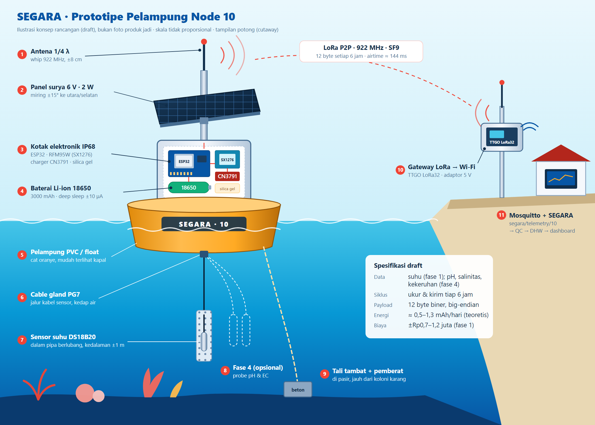
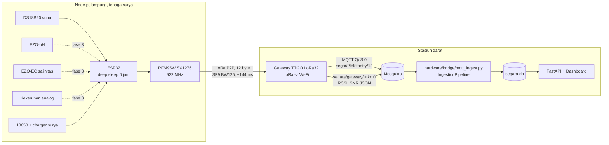

# Draft Prototipe IoT SEGARA

Status: **draft rancangan, belum pernah dirakit, di-flash, atau di-compile.** Firmware ditulis
untuk PlatformIO, tetapi belum ada toolchain ESP32 di mesin pengembang. Yang sudah terverifikasi
hanya bagian yang bisa diuji di Python (lihat [§8](#8-status-verifikasi)).

Tujuan prototipe: menggantikan pelampung virtual dengan pelampung fisik **tanpa mengubah
backend**. Node mengirim frame 12 byte yang sama ([docs/payload-spec.md](../docs/payload-spec.md))
ke topik MQTT yang sama (`segara/telemetry/{node_id}`), sehingga QC, DHW, peringatan, dan
dashboard yang ada langsung bekerja.

---



*Ilustrasi konsep (bukan foto), sumber vektor: [docs/prototipe-pelampung.svg](docs/prototipe-pelampung.svg).*

## 1. Arsitektur



Kenapa **LoRa point-to-point**, bukan LoRaWAN: backend sudah mengharapkan frame mentah 12 byte
di MQTT. Gateway P2P cukup meneruskan byte apa adanya, tanpa network server. Bila nanti pindah
ke LoRaWAN (mis. The Things Network, plan AS923-2), cukup tambahkan jembatan yang mengambil
`frm_payload` dari uplink TTN lalu menerbitkannya ke `segara/telemetry/{node_id}`; firmware
hanya perlu mengganti lapisan radio.

## 2. Tahapan (sesuai rencana pengembangan lanjutan)

| Fase | Isi | Sensor aktif (`config.h`) | Kriteria selesai |
|---|---|---|---|
| 1 | Prototipe suhu di meja | `HAS_DS18B20` | Paket muncul di dashboard sebagai node 10, counter berurutan |
| 2 | Kalibrasi suhu | `TEMP_CAL_A/B` | Selisih vs termometer referensi ≤ 0,1 °C pada 3 titik (mis. 25/29/32 °C) |
| 3 | Uji perairan dangkal | idem | 2 minggu tanpa kebocoran; packet loss & RSSI tercatat |
| 4 | Sensor tambahan | `HAS_EZO_PH`, `HAS_EZO_EC`, `HAS_TURBIDITY` | Kalibrasi pH 3 titik, EC dengan larutan standar, kekeruhan dengan standar NTU |

Selama sensor fase 4 belum terpasang, nilainya dikirim **0**. QC menandai `RANGE_FAIL` hanya
untuk parameter itu; suhu tetap dipakai DHW karena QC per parameter (diuji di
`tests/test_hardware_payload.py::test_temperature_only_prototype_still_feeds_dhw`).

## 3. Daftar komponen (BOM)

Harga adalah **kisaran perkiraan pasar Indonesia**, belum dicek ke penjual; gunakan untuk
anggaran kasar saja.

**Node fase 1 (suhu):**

| Komponen | Fungsi | Perkiraan |
|---|---|---|
| DFRobot FireBeetle ESP32 (atau modul ESP32 tanpa chip USB) | MCU; deep sleep ~10 µA. DevKit biasa boros (mA) karena LDO & USB-UART | Rp150–250 rb |
| RFM95W 915/923 MHz (SX1276) + antena 1/4λ | Radio LoRa | Rp120–200 rb |
| DS18B20 waterproof (kabel 3 m) + resistor 4,7 kΩ | Suhu, resolusi 0,0625 °C, akurasi pabrik ±0,5 °C | Rp20–40 rb |
| Sel 18650 3000 mAh + holder | Baterai | Rp50–80 rb |
| Panel surya 6 V 2 W + CN3791 (charger surya MPPT) | Pengisian | Rp100–170 rb |
| Load switch / P-MOSFET (mis. AO3401 + 2N7002) | Memutus daya sensor saat tidur | Rp5 rb |
| Resistor 470 kΩ ×2, kapasitor 100 nF | Pembagi tegangan baterai | Rp2 rb |
| Kotak IP68, cable gland PG7, silica gel | Kedap air | Rp100–200 rb |
| Pelampung (pipa PVC + jerigen/float), tali, pemberat | Struktur | Rp150–250 rb |
| **Subtotal fase 1** | | **±Rp0,7–1,2 juta** |

**Gateway:** LilyGO TTGO LoRa32 v2.1 (Rp250–400 rb) + adaptor 5 V; ditempatkan di darat dekat Wi-Fi.

**Fase 4 (opsional, mahal):** Atlas Scientific EZO-pH + probe (±Rp3–4 juta), EZO-EC + probe
K1.0 (±Rp4–5 juta), sensor kekeruhan analog (Rp150–300 rb; tipe hobi **bukan** kelas laut,
hanya untuk uji). Probe pH/EC perlu isolator tegangan (mis. Atlas "Basic EZO Inline Voltage
Isolator") bila dipasang bersamaan, agar tidak saling mengganggu.

## 4. Pengkabelan node

| ESP32 | Ke | Catatan |
|---|---|---|
| GPIO18 / 19 / 23 | RFM95W SCK / MISO / MOSI | SPI |
| GPIO5 | RFM95W NSS | |
| GPIO14 | RFM95W RESET | |
| GPIO26 | RFM95W DIO0 | interupsi TX selesai |
| GPIO4 | DS18B20 data | pull-up 4,7 kΩ ke rel sensor 3,3 V |
| GPIO25 | Gate load switch | HIGH = sensor menyala; pull-down 100 kΩ agar mati saat reset |
| GPIO21 / 22 | EZO SDA / SCL | fase 4; EZO harus diset mode I2C |
| GPIO34 | Keluaran sensor kekeruhan | lewat pembagi 10k/20k (maks 4,5 V → 3,0 V) |
| GPIO35 | Tengah pembagi 470k/470k baterai | + 100 nF ke GND |
| 3V3 / GND | Rel daya | RFM95W **tidak** di-switch (dibuat tidur lewat perintah) |

Semua pin bisa diubah di [firmware/node/include/config.h](firmware/node/include/config.h).
Pin gateway mengikuti TTGO LoRa32 v2.1 dan ada di
[firmware/gateway/src/main.cpp](firmware/gateway/src/main.cpp).

## 5. Alur firmware

**Node** ([firmware/node/src/main.cpp](firmware/node/src/main.cpp)), setiap 6 jam:

1. Bangun dari deep sleep, baca `counter` dari NVS.
2. Nyalakan rel sensor, tunggu 1,5 dtk, baca suhu (lalu pH/salinitas dengan kompensasi suhu bila aktif), kekeruhan, baterai.
3. Matikan rel sensor, encode 12 byte ([segara_payload.h](firmware/node/include/segara_payload.h)), kirim LoRa.
4. Simpan `counter + 1` ke NVS (tetap maju walau TX gagal → backend membacanya sebagai paket hilang), lalu tidur `6 jam − waktu bangun`.

Sensor DS18B20 yang terputus menghasilkan −127 °C dan dikirim apa adanya, sehingga QC menolaknya
(`RANGE_FAIL`) alih-alih dianggap valid.

**Gateway** ([firmware/gateway/src/main.cpp](firmware/gateway/src/main.cpp)): menerima paket
LoRa, menolak panjang ≠ 12 byte dan `node_id` di luar 10–49 (1–5 milik simulator), menerbitkan
byte mentah ke `segara/telemetry/{id}` dan RSSI/SNR ke `segara/gateway/link/{id}`.

## 6. Anggaran energi teoretis

Dihitung dari angka datasheet tipikal, **bukan pengukuran**.

| Fase siklus | Arus | Durasi | Muatan |
|---|---|---|---|
| Bangun + ukur (ESP32 ~45 mA, DS18B20 ~1 mA) | ~46 mA | ~2,5 dtk | 0,032 mAh |
| TX LoRa 14 dBm, 12 byte SF9/BW125 (airtime ≈ 144 ms) | ~45 mA | 0,15 dtk | 0,002 mAh |
| **Per siklus** | | | **≈ 0,034 mAh** |
| 4 siklus/hari | | | 0,14 mAh |
| Tidur 24 jam (ESP32 ~10 µA + pembagi ~4 µA + RFM95W tidur ~1 µA + charger ~?) | ~15–50 µA | 24 jam | 0,36–1,2 mAh |
| **Total per hari** | | | **≈ 0,5–1,3 mAh** |

Kesimpulan: konsumsi didominasi arus tidur dan arus diam charger, bukan pengukuran atau radio.
Dengan sel 3000 mAh, baterai saja secara teoretis bertahan > 1 tahun; panel 2 W jauh melebihi
kebutuhan. Fase 4 menambah EZO-pH/EC (~20–50 mA masing-masing, ~1 dtk per baca), masih kecil.
Angka nyata **harus diukur** dengan ampermeter seri / power profiler.

## 7. Menjalankan ujung-ke-ujung

1. Jalankan broker: `docker compose -f infra/docker-compose.yml up mosquitto` atau Mosquitto lokal (port 1883).
2. Gateway: salin `firmware/gateway/include/secrets.example.h` → `secrets.h`, isi Wi-Fi & IP broker, lalu `pio run -e gateway -t upload` dari `hardware/firmware/gateway`.
3. Node: atur `NODE_ID` dan (untuk uji meja) `DEBUG_FAST_CYCLE 1`, lalu `pio run -e node -t upload` dari `hardware/firmware/node`.
4. Jembatan ingestion (dari akar repo):
   ```bash
   python -m hardware.bridge.mqtt_ingest --broker 127.0.0.1 --node-id 10 --lat -6.12 --lon 106.83 --mmm 29.5
   ```
5. Jalankan API & dashboard seperti biasa (`python run_segara.py`); node 10 tampil dari DB yang sama.

Catatan uji meja: dengan `DEBUG_FAST_CYCLE 1` node mengirim tiap 60 dtk, tetapi backend tetap
menganggap tiap paket = 6 jam. DHW dari uji meja karenanya **tidak bermakna**; yang diuji hanya
alur data. Kembalikan ke 0 sebelum dipasang.

## 8. Status verifikasi

| Bagian | Status |
|---|---|
| Format payload C = Python | Vektor uji bersama di [test_vectors.json](test_vectors.json); sisi Python lulus. Sisi C (`pio test -e native`) **belum dijalankan** |
| Registrasi node & alur paket suhu-saja ke DHW | Lulus (`tests/test_hardware_payload.py`, suite penuh 82 passed) |
| Compile firmware node & gateway | **Belum** (tanpa toolchain ESP32) |
| Radio, sensor, daya, kedap air | **Belum dirakit** |
| Broker MQTT nyata + jembatan | **Belum dijalankan** |

## 9. Batasan & risiko yang diketahui

- **Jam observasi diturunkan dari counter** (counter × 6 jam). Frame 12 byte tidak membawa
  waktu. Bila node mati lama (baterai habis) lalu hidup lagi, counter melanjutkan dari NVS dan
  backend menganggap hanya 1 siklus berlalu → jendela DHW bergeser. Mitigasi lanjutan: gateway
  mencatat waktu terima, atau tambah RTC eksternal (DS3231) dan field waktu di payload versi 2.
- **Osilator RTC internal ESP32 meleset beberapa persen** → jadwal 6 jam bisa bergeser belasan
  menit per siklus. Tidak memengaruhi DHW (waktu dari counter), tetapi pakai kristal 32 kHz
  bila perlu jadwal tepat.
- **Akurasi DS18B20 ±0,5 °C** sebelum kalibrasi, sedangkan ambang pemutihan berjarak 1 °C dari
  MMM. Kalibrasi fase 2 wajib; alternatif lebih baik: PT100 + MAX31865.
- **LoRa P2P tanpa autentikasi/enkripsi**: siapa pun di 922 MHz dengan sync word yang sama
  bisa mengirim frame palsu. Diterima untuk prototipe; produksi butuh LoRaWAN (AES-128) atau MAC.
- **Gateway tanpa buffer**: bila Wi-Fi/MQTT putus, paket hilang (terdeteksi sebagai `PACKET_LOSS`).
- **Regulasi frekuensi**: pita 920–923 MHz di Indonesia; batas daya pancar dan sertifikasi
  perangkat perlu dicek ke ketentuan terbaru sebelum uji lapangan.
- **Biofouling, korosi, dan kebocoran** belum ditangani dalam rancangan ini; probe pH/EC di laut
  biasanya perlu dibersihkan dan dikalibrasi ulang tiap beberapa minggu.
- **MMM node prototipe** diisi manual lewat `--mmm`; idealnya diambil dari klimatologi CRW untuk
  piksel lokasi pemasangan.
